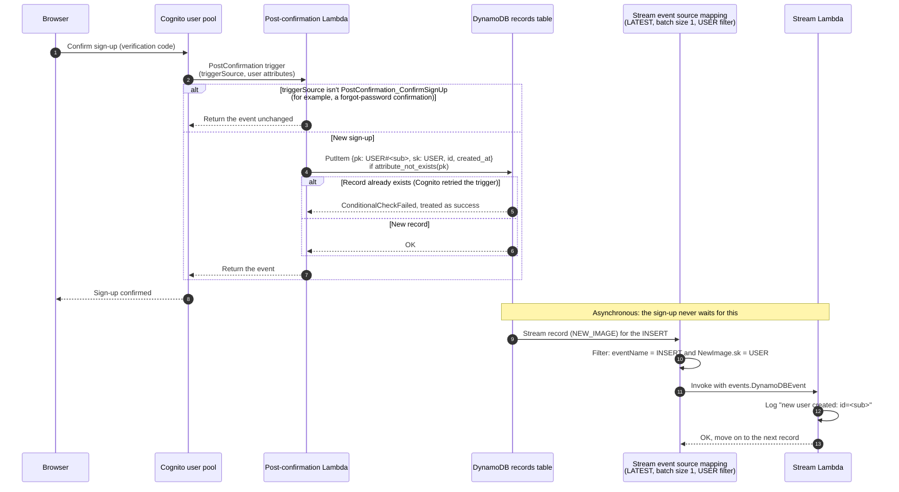
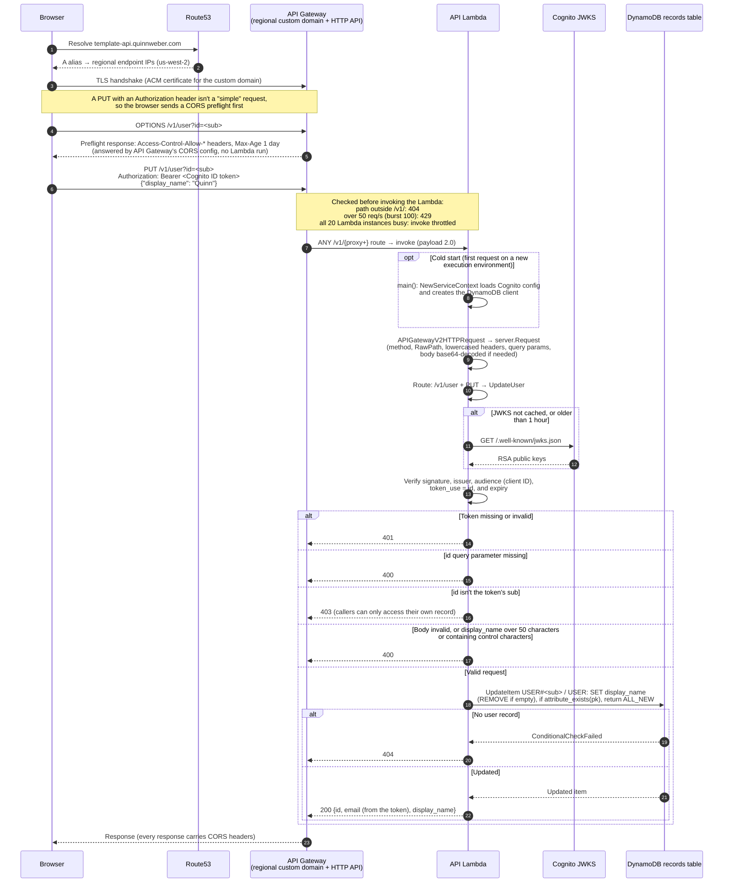

# Request lifecycle

This page follows the two flows that touch every part of the stack:

1. **Signing up**, which creates the user's record through a Cognito trigger and then fans out
   through the DynamoDB stream.
2. **Updating your display name**, an authenticated API request from DNS lookup to response.

The other routes take a subset of the second path: `GET /v1/user` reads instead of updating, and
`/v1/ping` skips authentication and the data layer entirely.

## Components

| Component | Defined in | Role |
| --- | --- | --- |
| Route53 alias record | `cdk/domain.go` | Resolves `template-api.quinnweber.com` (`dev-template-api…` for dev) to the API Gateway regional endpoint in us-west-2. |
| API Gateway custom domain | `cdk/domain.go` | Regional endpoint that terminates TLS with the domain's ACM certificate and maps the domain root to the HTTP API's `$default` stage. |
| HTTP API | `cdk/apigateway.go` | API Gateway v2 with one `ANY /v1/{proxy+}` route and an `AWS_PROXY` Lambda integration (payload format 2.0). It answers CORS preflights itself, returns `404` for paths outside `/v1/` without invoking the Lambda, and its stage throttles at 50 requests/second with bursts up to 100, answering `429` beyond that. Its default `execute-api` endpoint is disabled, so the custom domain is the only way in. |
| API access logs | `cdk/apigateway.go` | One JSON line per request that reaches the stage, in the `/aws/apigateway/go-template-<env>-api-access` log group (kept 14 days). |
| API Lambda | `cmd/apigateway`, `internal/server` | Converts the event to a `server.Request` and does routing within `/v1/`, Cognito token verification, and data access. Reserved concurrency caps it at 20 instances running at once. |
| Cognito user pool | `cdk/cognito.go`, `internal/auth` | Handles sign-up and sign-in, issues the ID tokens the browser sends, serves the JWKS public keys the API verifies them with, and invokes the post-confirmation trigger. |
| Post-confirmation Lambda | `cmd/postconfirmation`, `cdk/cognito_trigger.go` | Creates the user's record when they confirm their sign-up. |
| DynamoDB records table | `cdk/dynamo.go`, `internal/repositories` | Single table holding every entity, keyed by `pk` and `sk`. A user is `pk = USER#<Cognito sub>`, `sk = USER`. Its stream emits each new item. |
| Stream Lambda | `cmd/dynamostream`, `cdk/stream.go` | Consumes the table's stream asynchronously, filtered to newly created `USER` records. |

## Signing up



Notes:

1. **Only sign-up confirmations create users.** Cognito also fires the trigger after a
   forgot-password confirmation, which the Lambda ignores.
2. **The write can safely be repeated.** If Cognito retries the trigger, the conditional `PutItem`
   fails, the repository treats that as success, and the existing record is left untouched. If the
   write fails for any other reason, the Lambda returns an error, which Cognito passes back to the
   confirmation request.
3. **No email is stored.** The user record has the Cognito `sub` as its id and a creation time.
   Email stays in Cognito and reaches the API through the ID token.
4. **The stream is filtered at the source.** The event source mapping only invokes the stream
   Lambda for new `USER` records, so later updates (like a display name change) and other entity
   types never reach it. The handler also checks the event name and sort key itself, and it always
   returns success, so a record is never retried.

## Updating your display name



Notes:

1. **DNS:** the record is a Route53 alias, so resolvers get API Gateway's regional IP addresses
   directly. There is no CloudFront in front of the API.
2. **TLS:** the handshake ends at API Gateway in us-west-2, using the certificate issued for the
   custom domain in that region. A browser reuses the connection for later requests, including the
   real request after the preflight. The `execute-api` hostname is disabled, so this domain is the
   only way to reach the API.
3. **Routing:** API Gateway only forwards `/v1/...` paths, through the `ANY /v1/{proxy+}` route.
   Other paths get a `404` from API Gateway without invoking the Lambda. Within `/v1/`,
   `internal/server` routes the request and returns `404` for unknown paths and `405` for methods
   `/v1/user` doesn't support.
4. **Preflights:** CORS is configured on the HTTP API, so API Gateway answers `OPTIONS` preflights
   itself, with `Access-Control-Max-Age` set to one day. Browsers cache the preflight result, so
   repeat requests skip it, and preflights never invoke the Lambda.
5. **Cold start:** `main()` builds the service context once per Lambda execution environment,
   before it starts taking requests. It reads configuration and creates clients but makes no
   network calls. Warm invocations skip it.
6. **Auth:** the Cognito keys are cached in the execution environment for an hour, so most
   requests verify the token without any network call. If the Cognito environment variables are
   missing, the verifier is `nil` and authenticated routes return 401.
7. **Response:** `email` comes from the caller's verified ID token, not the table, and
   `display_name` comes from the item `UpdateItem` returns.
8. **Burst limits:** the `$default` stage allows 50 requests/second steady with bursts up to 100,
   shared by all clients. Past that, API Gateway answers `429 Too Many Requests` before any Lambda
   runs, so a flood costs no invocations. Separately, the API Lambda's reserved concurrency of 20
   caps how many instances run at once (bounding cost) and guarantees it that capacity from the
   account-wide pool. A request arriving while all 20 are busy is throttled by Lambda, and API
   Gateway returns an error instead of a response. Both limits are constants at the top of
   `cdk/apigateway.go`.

## Reading your user record

`GET /v1/user?id=<sub>` takes the same path as the update, including a preflight (the
`Authorization` header triggers one for any method, though browsers reuse a cached preflight for a
day), with two differences:

- **No body validation:** there's no body to validate.
- **A read instead of a write:** the Lambda calls `GetItem` on `USER#<sub>` / `USER` and returns
  404 if the record doesn't exist.

## Finding out who's calling the API

The HTTP API's stage writes one JSON line per request to the
`/aws/apigateway/go-template-<env>-api-access` log group. That includes requests that never reach
the Lambda, such as preflights, throttled `429`s and `404`s for paths outside `/v1/` (those have
an empty `integrationLatency`). Each line has the request ID and time, `sourceIp`, `userAgent`,
`domainName`, `method`, `path`, `status`, response size and latency, the integration latency, and
any error message.

The API Lambda also logs one JSON line per invocation (`"msg":"request"`) to its own log group,
`/aws/lambda/go-template-<env>-apigateway-function`. Each line has `requestId`, `method`, `path`,
`status`, `durationMs`, `sourceIp` and `userAgent`. The `requestId` matches the access log's, so a
`REPORT` line in the Lambda's logs can be tied back to its caller. Headers, bodies and query strings
are never logged, because they carry bearer tokens, user input and user ids.

To see what's generating traffic, run this in CloudWatch Logs Insights against the access log group:

```
fields @timestamp, method, path, status, userAgent, sourceIp
| stats count(*) as requests by method, path, status, userAgent
| sort requests desc
| limit 50
```

Typical sources of traffic that doesn't come from the website:

- **Internet scanners:** probes for paths like `/.env` or `/wp-login.php`, usually with a script or
  scanner user agent. API Gateway answers those outside `/v1/` with a `404` and never invokes the
  Lambda.
- **Certificate Transparency watchers:** every ACM certificate is published in public CT logs, and
  scanners start probing a new hostname soon after its certificate is issued.
- **CI:** every deploy, including pull request deploys to dev, calls `/v1/ping?cb=<run id>` with
  `curl`.
