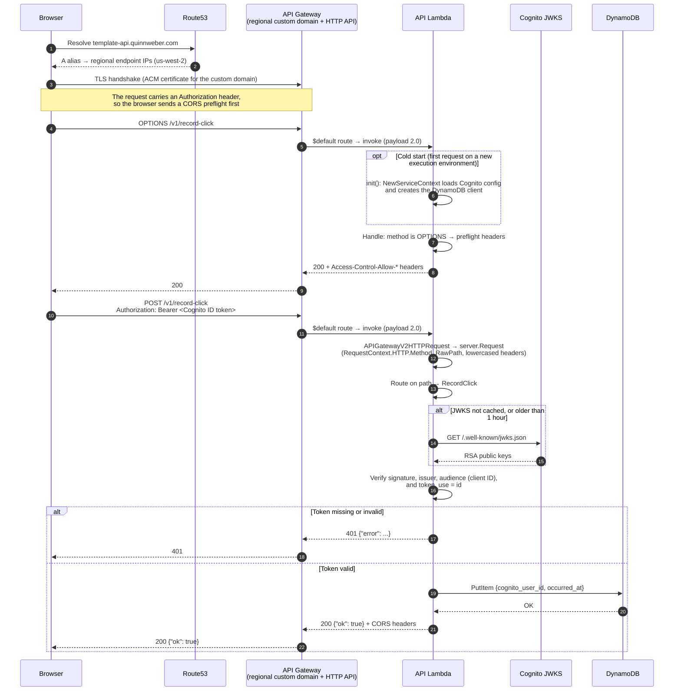
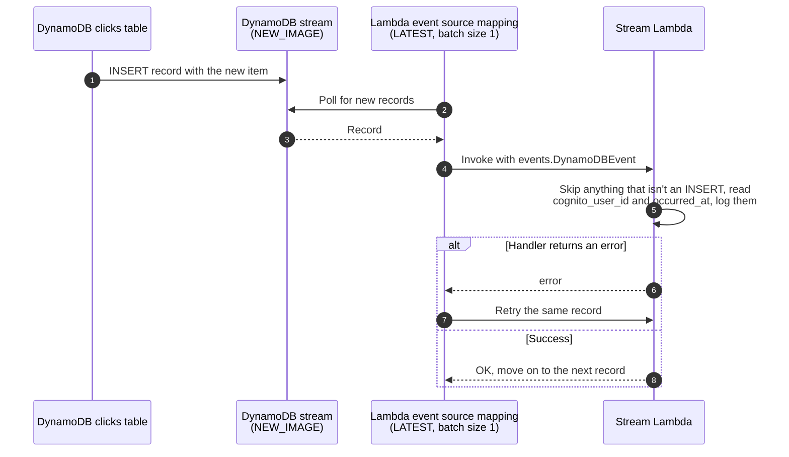

# Request lifecycle

This page follows one authenticated request, a browser recording a click, from DNS lookup to
response, and then the asynchronous work it triggers. The other routes take a subset of the same
path: `/v1/ping` and `/v1/click-count` skip authentication, and simple requests without an
`Authorization` header skip the CORS preflight.

## Components

| Component | Defined in | Role |
| --- | --- | --- |
| Route53 alias record | `cdk/domain.go` | Resolves `template-api.quinnweber.com` (`dev-template-api…` for dev) to the API Gateway regional endpoint in us-west-2. |
| API Gateway custom domain | `cdk/domain.go` | Regional endpoint that terminates TLS with the domain's ACM certificate and maps the domain root to the HTTP API's `$default` stage. |
| HTTP API | `cdk/apigateway.go` | API Gateway v2 with one catch-all `$default` route and an `AWS_PROXY` Lambda integration (payload format 2.0). It does no routing, auth, or CORS of its own. |
| API Lambda | `cmd/apigateway`, `internal/server` | Converts the event to a `server.Request` and does routing, CORS, Cognito token verification, and data access. |
| Cognito | `cdk/cognito.go`, `internal/auth` | Issues the ID tokens the browser sends, and serves the JWKS public keys the Lambda verifies them with. |
| DynamoDB clicks table | `cdk/dynamo.go`, `internal/repositories` | Stores one item per click. Its stream emits each new item. |
| Stream Lambda | `cmd/dynamostream`, `cdk/stream.go` | Consumes the table's stream asynchronously, one record per invocation. |

## Recording a click

Notes:

1. **DNS:** the record is a Route53 alias, so resolvers get API Gateway's regional IP addresses
   directly. There is no CloudFront in front of the API.
2. **TLS:** the handshake ends at API Gateway in us-west-2, using the certificate issued for the
   custom domain in that region. A browser reuses the connection for later requests, including the
   real request after the preflight.
3. **Routing:** API Gateway forwards every method and path through the `$default` route. All
   routing, including `OPTIONS` preflights and 404s, happens in `internal/server`.
4. **Cold start:** `init()` runs once per Lambda execution environment, before its first request.
   It reads configuration and creates clients but makes no network calls. Warm invocations skip it.
5. **Auth:** the Cognito keys are cached in the execution environment for an hour, so most
   requests verify the token without any network call. If the Cognito environment variables are
   missing, the verifier is `nil` and authenticated routes return 401.

## After the write: the DynamoDB stream

The click's `PutItem` also produces a stream record. The stream Lambda processes it
asynchronously: the API response doesn't wait for it, and a failure there never affects the
request.

## Reading the click count

`/v1/click-count` takes the same path as above without the preflight or auth steps. The Lambda
calls `DescribeTable` and returns the table's `ItemCount`. DynamoDB refreshes that value roughly
every six hours, so the count is approximate and can lag recent clicks.
