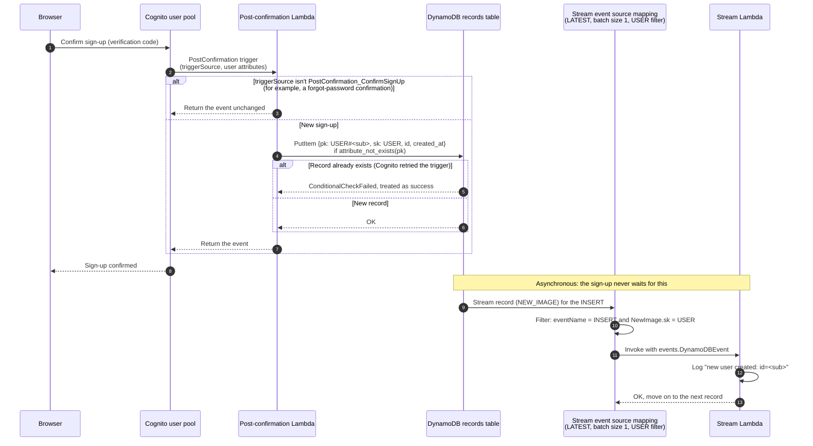
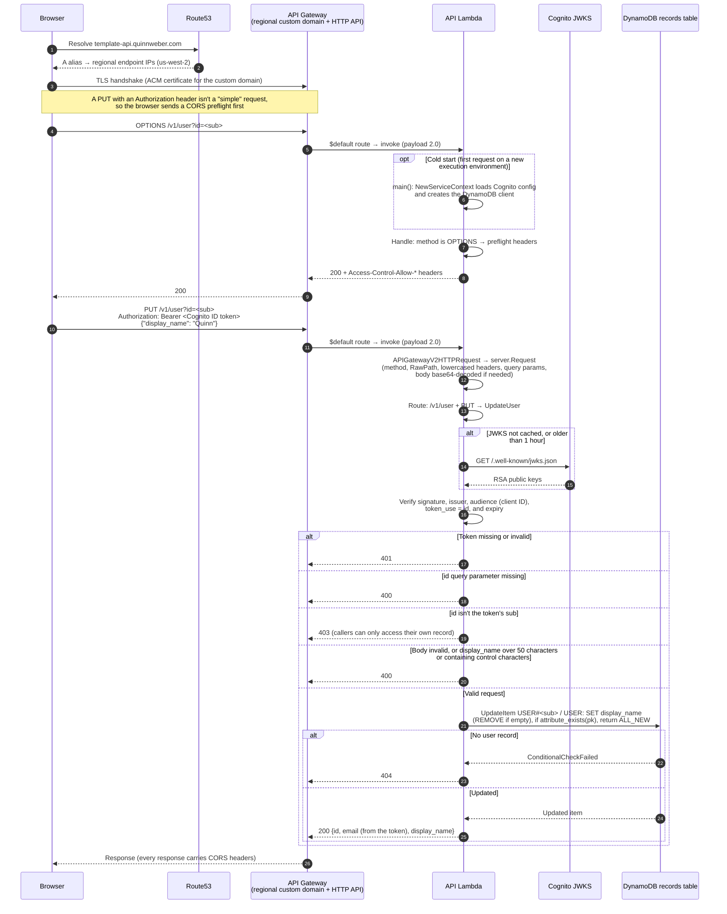

# Request lifecycle

This page follows the two flows that touch every part of the stack:

1. **Signing up**, which creates the user's record through a Cognito trigger and then fans out
   through the DynamoDB stream.
2. **Updating your display name**, an authenticated API request from DNS lookup to response.

The other routes take a subset of the second path: `GET /v1/user` reads instead of updating, and
`/v1/ping` skips authentication and the data layer entirely.

## Components

| Component | Defined in | Role |
| --- | --- | --- |
| Route53 alias record | `cdk/domain.go` | Resolves `template-api.quinnweber.com` (`dev-template-api…` for dev) to the API Gateway regional endpoint in us-west-2. |
| API Gateway custom domain | `cdk/domain.go` | Regional endpoint that terminates TLS with the domain's ACM certificate and maps the domain root to the HTTP API's `$default` stage. |
| HTTP API | `cdk/apigateway.go` | API Gateway v2 with one catch-all `$default` route and an `AWS_PROXY` Lambda integration (payload format 2.0). It does no routing, auth, or CORS of its own. |
| API Lambda | `cmd/apigateway`, `internal/server` | Converts the event to a `server.Request` and does routing, CORS, Cognito token verification, and data access. |
| Cognito user pool | `cdk/cognito.go`, `internal/auth` | Handles sign-up and sign-in, issues the ID tokens the browser sends, serves the JWKS public keys the API verifies them with, and invokes the post-confirmation trigger. |
| Post-confirmation Lambda | `cmd/postconfirmation`, `cdk/cognito_trigger.go` | Creates the user's record when they confirm their sign-up. |
| DynamoDB records table | `cdk/dynamo.go`, `internal/repositories` | Single table holding every entity, keyed by `pk` and `sk`. A user is `pk = USER#<Cognito sub>`, `sk = USER`. Its stream emits each new item. |
| Stream Lambda | `cmd/dynamostream`, `cdk/stream.go` | Consumes the table's stream asynchronously, filtered to newly created `USER` records. |

## Signing up

Notes:

1. **Only sign-up confirmations create users.** Cognito also fires the trigger after a
   forgot-password confirmation, which the Lambda ignores.
2. **The write can safely be repeated.** If Cognito retries the trigger, the conditional `PutItem`
   fails, the repository treats that as success, and the existing record is left untouched. If the
   write fails for any other reason, the Lambda returns an error, which Cognito passes back to the
   confirmation request.
3. **No email is stored.** The user record has the Cognito `sub` as its id and a creation time.
   Email stays in Cognito and reaches the API through the ID token.
4. **The stream is filtered at the source.** The event source mapping only invokes the stream
   Lambda for new `USER` records, so later updates (like a display name change) and other entity
   types never reach it. The handler also checks the event name and sort key itself, and it always
   returns success, so a record is never retried.

## Updating your display name

Notes:

1. **DNS:** the record is a Route53 alias, so resolvers get API Gateway's regional IP addresses
   directly. There is no CloudFront in front of the API.
2. **TLS:** the handshake ends at API Gateway in us-west-2, using the certificate issued for the
   custom domain in that region. A browser reuses the connection for later requests, including the
   real request after the preflight.
3. **Routing:** API Gateway forwards every method and path through the `$default` route. All
   routing happens in `internal/server`, including `OPTIONS` preflights, 404s for unknown paths,
   and 405s for methods `/v1/user` doesn't support.
4. **Cold start:** `main()` builds the service context once per Lambda execution environment,
   before it starts taking requests. It reads configuration and creates clients but makes no
   network calls. Warm invocations skip it.
5. **Auth:** the Cognito keys are cached in the execution environment for an hour, so most
   requests verify the token without any network call. If the Cognito environment variables are
   missing, the verifier is `nil` and authenticated routes return 401.
6. **Response:** `email` comes from the caller's verified ID token, not the table, and
   `display_name` comes from the item `UpdateItem` returns.

## Reading your user record

`GET /v1/user?id=` takes the same path as the update, including the preflight (the
`Authorization` header triggers one for any method), with two differences:

- **No body validation:** there's no body to validate.
- **A read instead of a write:** the Lambda calls `GetItem` on `USER#` / `USER` and returns
  404 if the record doesn't exist.

The preflight response doesn't set `Access-Control-Max-Age`, so browsers fall back to caching it
for about 5 seconds, and nearly every authenticated request costs an extra round trip. Setting a
longer max age in `preflightHeaders` would remove most of them.
